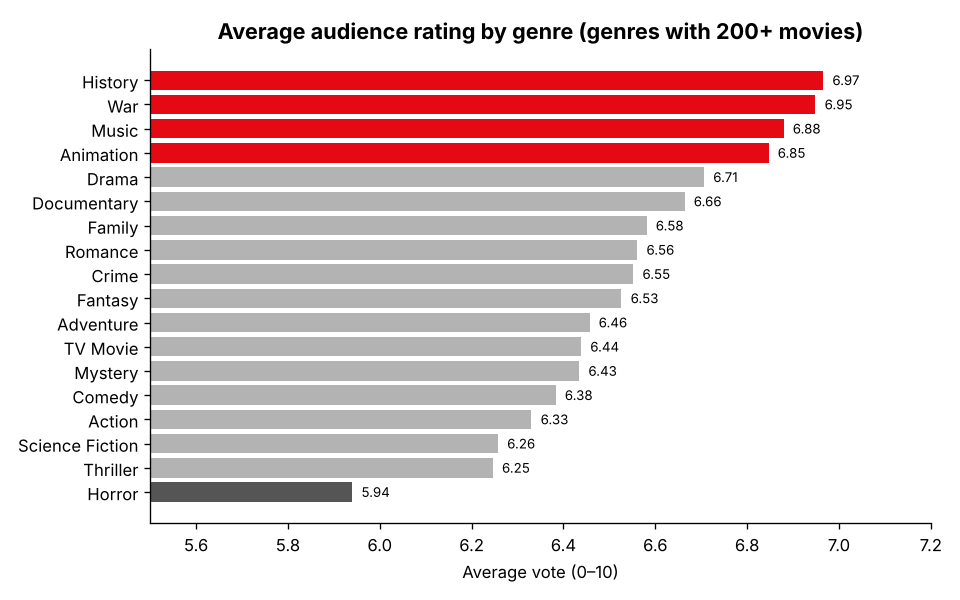
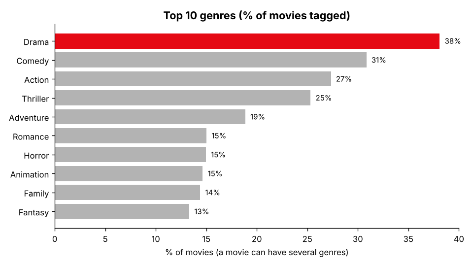
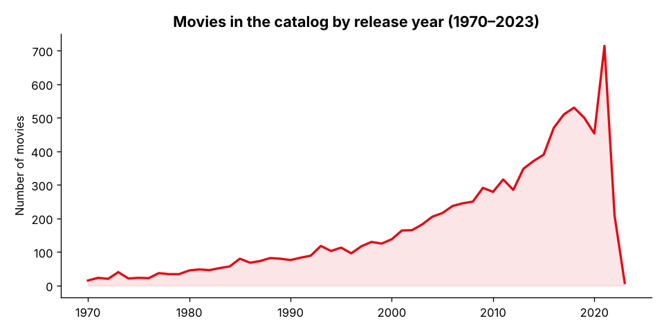
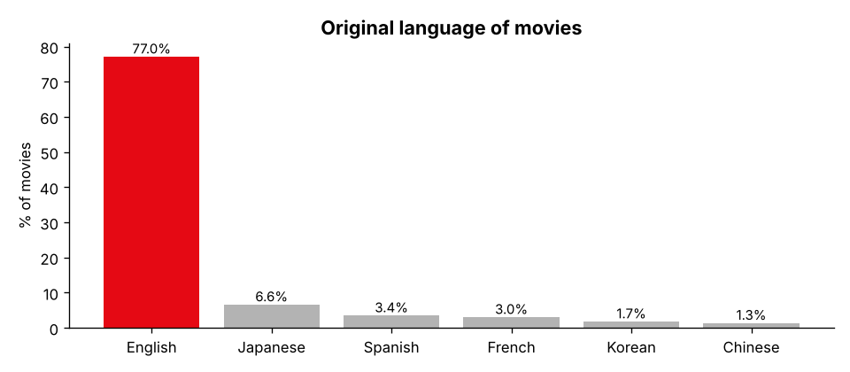

# 🎬 Netflix Movie Catalog Analysis

**An exploratory analysis of 9,827 movies (with TMDB popularity and audience-rating data) to answer a content-strategy question: which genres are most common, which ones audiences rate highest, and where popularity and quality don't line up.**




---

## 📌 Key findings

1. **Drama dominates the catalog.** 38% of movies are tagged Drama, followed by Comedy (31%), Action (27%) and Thriller (25%).
2. **Animation is the "sweet spot" genre.** It has the highest median popularity of any major genre *and* one of the highest audience ratings (6.85/10). That makes it a strong candidate for investment.
3. **Popular isn't the same as well-rated.** Science Fiction and Action are among the six most popular genres but sit in the bottom four for ratings (6.26 and 6.33). They draw attention but don't leave audiences as satisfied.
4. **Horror is the lowest-rated genre** (5.94/10), even though 15% of the catalog is horror.
5. **Niche genres rate highest.** History (6.97), War (6.95) and Music (6.88) top the ratings but make up a small share of titles. They could be an under-served audience.
6. **The catalog skews recent and English-language.** 55% of movies were released in 2010 or later, and 77% are originally in English. Japanese (6.6%) is the largest non-English language, largely because of anime.

| Genre share | Releases over time | Original language |
|---|---|---|
|  |  |  |

---

## 📊 Dataset

[`data/movies.csv`](data/movies.csv) contains **9,827 movies** with no missing values or duplicates.

| Column | Description |
|---|---|
| `Release_Date` | Release date (1902–2024) |
| `Title`, `Overview` | Movie title and plot summary |
| `Popularity` | TMDB popularity score |
| `Vote_Count`, `Vote_Average` | Number of audience votes and average rating (0–10) |
| `Original_Language` | ISO language code |
| `Genre` | Comma-separated list of genres (19 unique) |
| `Poster_Url` | Poster image link |

---

## 🧹 Approach

1. **Explore:** shape, data types, missing values and duplicates
2. **Clean:** convert release dates to years and drop columns not needed for the analysis
3. **Reshape:** split multi-genre strings and *explode* them, so each movie–genre pair is one row
4. **Engineer:** bucket `Vote_Average` into quartile-based categories (not popular → popular)
5. **Analyze & visualize:** genre frequency, rating distribution, most and least popular titles, and release trends

---

## ▶️ How to run

```bash
git clone https://github.com/1998-aish/Netflix-Analysis.git
cd Netflix-Analysis
pip install -r requirements.txt

jupyter notebook notebooks/movie_analysis.ipynb   # full exploratory analysis
python src/make_charts.py                         # regenerate the README charts
```

---

## 📁 Repository structure

```
Netflix-Analysis/
├── data/
│   └── movies.csv               # 9,827 movies
├── notebooks/
│   └── movie_analysis.ipynb     # cleaning, EDA and visualizations
├── src/
│   └── make_charts.py           # reproducible charts for this README
├── images/                      # generated charts
├── requirements.txt
└── README.md
```

---

## 🔭 Next steps

- Build an interactive dashboard (Tableau or Streamlit) with filters for genre, language and decade
- Test whether rating differences between genres are statistically significant
- Use the plot summaries (`Overview`) for NLP-based genre clustering or a simple recommender

---

## 👩‍💻 Author

**Aishwarya Srivastava**: M.S. Data Science & Analytics, Arizona State University
[LinkedIn](https://www.linkedin.com/in/aish-sv123) · [GitHub](https://github.com/1998-aish)
